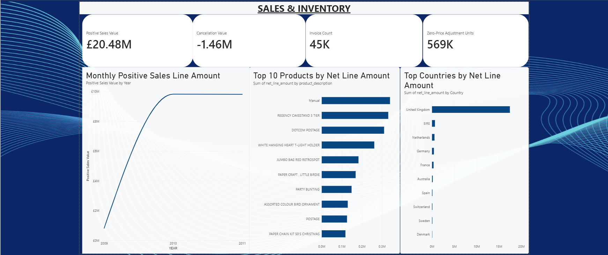
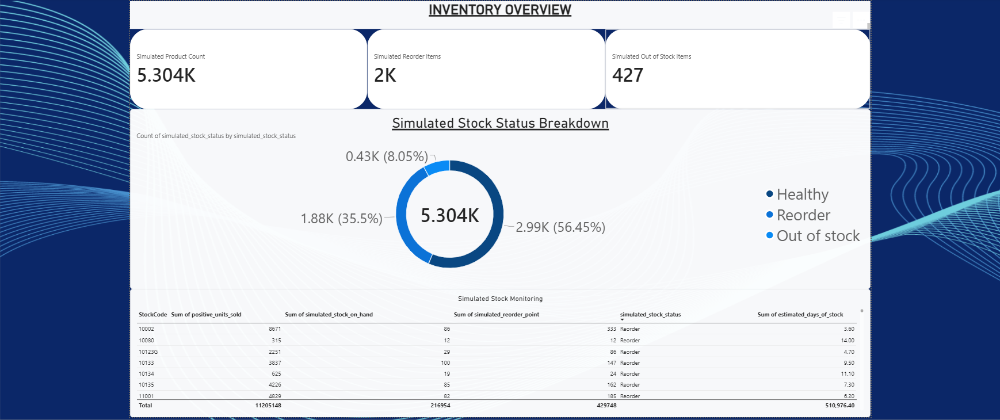

# Sales & Inventory Reporting Pipeline

A data analytics portfolio project using Python, SQL, SQLite, and Power BI to transform retail transaction data into business reporting outputs.

## Overview

This project demonstrates a practical reporting workflow, from raw data preparation to SQL-based analysis and Power BI dashboard development.

The pipeline processes the UCI Online Retail II dataset, standardizes and cleans transaction records, loads the cleaned data into SQLite, generates reporting views, and exports datasets for visualization.

It also includes a **simulated inventory analysis** to demonstrate how sales history can be used to create illustrative stock-status indicators. These inventory quantities are synthetic and do not represent actual warehouse stock.

## Dashboard Preview

### Sales Overview



### Inventory Overview



> **Note:** Inventory quantities and stock-status classifications
> are simulated for demonstration purposes.

## Business Questions

The project is designed to answer the following questions:

- How does positive sales line amount change over time?
- How many non-cancellation invoices are recorded each month?
- What cancellation line amounts appear in the transaction data?
- Which products have the highest reported net line amounts?
- Which countries contribute the most to reported retail line amounts?
- How many transaction lines represent negative-quantity, zero-price adjustments?
- How could historical sales data support a basic, illustrative inventory-monitoring report?

## Tools & Technologies

- **Python:** data profiling, cleaning, transformation, and report automation
- **Pandas:** data manipulation and CSV processing
- **SQLite:** structured storage and SQL reporting
- **SQL:** aggregation, reporting views, and business analysis
- **Power BI Desktop:** interactive reporting and visualization
- **Git & GitHub:** version control and project documentation

## Dataset

**Source:** [UCI Machine Learning Repository — Online Retail II](https://archive.ics.uci.edu/dataset/502/online+retail+ii)

The dataset contains retail transactions from a UK-based online retailer across two periods, 2009–2010 and 2010–2011.

The original workbook contains fields including invoice number, product code, product description, quantity, invoice date, unit price, customer ID, and country.

The source dataset is licensed under **CC BY 4.0**. Please consult the original dataset page for its attribution requirements and terms.

The original workbook is not included in this repository. Download it from the source above and place it at:

`data/raw/online_retail_II.xlsx`

## Pipeline

1. **Profile the source data** to inspect its structure and quality.
2. **Clean and standardize transactions**, including column names, duplicate records, and rejected rows.
3. **Load cleaned transactions into SQLite** for structured querying.
4. **Create SQL reporting views** for monthly sales, product performance, and country performance.
5. **Generate simulated inventory indicators** for demonstration purposes.
6. **Export reporting datasets** to CSV for Power BI.
7. **Visualize the results** in a Power BI report.

## Data Quality Results

The current cleaning run processed 1,067,371 source rows.

| Metric | Result |
|---|---:|
| Source rows | 1,067,371 |
| Duplicate rows removed | 34,335 |
| Rejected rows | 5 |
| Cleaned rows | 1,033,031 |

These figures describe the current run of the cleaning script. Re-run the pipeline if you change the source workbook or cleaning logic.

## Reporting Outputs

The export script produces four CSV files:

| File | Purpose |
|---|---|
| `monthly_sales.csv` | Monthly invoice counts, positive sales line amounts, cancellation line amounts, and zero-price adjustment indicators |
| `product_performance.csv` | Product-level performance reporting |
| `country_performance.csv` | Country-level performance reporting |
| `simulated_inventory.csv` | Illustrative stock quantities, reorder indicators, and estimated days of stock |

The current exports contain 25 monthly records, 5,298 product records, 43 country records, and 5,304 simulated inventory records.

## Important Definitions & Limitations

### Sales values

Positive sales line amount is calculated from transaction lines that are not cancellation invoices and have positive quantities and positive unit prices.

Cancellation line amount is reported separately for cancellation invoices. It is typically negative in this dataset.

These measures are **transaction line-amount reporting metrics**, not independently verified accounting revenue, profit, or cash received. They should not be interpreted as a complete financial reconciliation.

### Zero-price adjustments

Some non-cancellation transactions have negative quantities and zero unit prices. These are tracked separately as operational adjustment indicators rather than being treated as ordinary monetary sales or returns.

### Simulated inventory

The dataset does not provide actual inventory-on-hand quantities. Therefore, the inventory script generates synthetic stock quantities and illustrative statuses using historical sales-derived values.

The resulting `Healthy`, `Reorder`, and `Out of stock` classifications are for demonstration only. The synthetic quantities and reorder rules are not validated inventory forecasts and should not be used for operational stock decisions.

## Project Structure

```text
sales-inventory-reporting-pipeline/
├── data/
│   ├── raw/                  # Original workbook (download separately)
│   └── processed/            # Generated datasets
├── database/                 # Generated SQLite database
├── logs/                     # Processing logs
├── reports/
│   └── exports/              # Power BI-ready CSV reports
├── sql/
│   └── 01_sales_reports.sql
├── src/
│   ├── profile_data.py
│   ├── clean_data.py
│   ├── inspect_negative_rows.py
│   ├── load_sqlite.py
│   ├── sql_reports.py
│   ├── create_inventory_demo.py
│   └── export_reports.py
├── tests/
├── requirements.txt
├── .gitignore
└── README.md
```

Generated files and exact folder contents may vary as the project evolves.

## Setup & Usage

### 1. Clone the repository

```bash
git clone https://github.com/Lennyium/sales-inventory-reporting-pipeline.git
cd sales-inventory-reporting-pipeline
```

Replace `YOUR-USERNAME` with your GitHub username.

### 2. Create a virtual environment

Windows:

```bash
python -m venv .venv
.venv\Scripts\activate
```

### 3. Install dependencies

```bash
python -m pip install -r requirements.txt
```

### 4. Add the source dataset

Download Online Retail II from the UCI link above and place `online_retail_II.xlsx` inside `data/raw/`.

### 5. Run the pipeline

Run the scripts from the project root in the order below. Ensure each step finishes successfully before proceeding.

```bash
python src/profile_data.py
python src/clean_data.py
python src/load_sqlite.py
python src/sql_reports.py
python src/create_inventory_demo.py
python src/export_reports.py
```

The inspection script `src/inspect_negative_rows.py` can be run separately when investigating negative-quantity transactions.

### 6. Open the Power BI report

Open the saved `.pbix` file, if included in the repository. Otherwise, open Power BI Desktop and import the CSV files from `reports/exports/`.

## Future Improvements

- Add automated tests for data quality and reporting logic.
- Add validation checks and clearer pipeline error handling.
- Improve inventory analysis using actual stock data, if available.
- Refine dashboard layout, filtering, and visual design.
- Automate report refresh and export steps.

## Acknowledgements

Dataset: Chen, D. (2019). *Online Retail II* [Dataset]. UCI Machine Learning Repository. https://doi.org/10.24432/C5CG6D

This is an independent portfolio project for demonstrating data preparation, SQL reporting, automation, and business intelligence skills.
